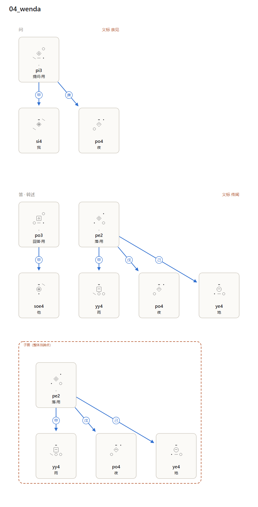

# 洄文（huíwén）

> 一门**自源文字 + 图语法**的人造语言，配一部**中洄双语大字典**与一本**零基础教程**。
> **15000 字 / 3000 词 / 624 音节 / 44 语义类 / 全书 131.8 万字**——全部可复算、可校验。



---

## 〇、先看这两本书

| 书 | 文件 | 规模 | 给谁看 |
|---|---|---|---|
| **《洄文大字典》** | `dict/洄文大字典.md`（6.9 MB）／`.docx`（616 KB） | **131.8 万字**，3000 词条 | 想查词、想细究的人 |
| **《洄文入门》** | `course/` 六篇（已并入大字典开头的「教程」部分） | 五编二十课 | **只懂中文、零基础**的人 |

两本都是**中洄双语**，站在「只会汉语读者」的位置写：
每个字的发音都用汉语可比的说法讲（`p` 读如汉语 `b`、`y` 就是汉语的 `ü`……），
每条词义都有中文释义、中文辨析、中洄对照例句。

**一条命令可复算全部内容**（含这两本书）：

```powershell
python huiwen/tools/hwselftest.py
```

---

## 一、这门语言是什么

洄文有**两套互不相同**的符号机制，这是它与自然语言最根本的分岔：

| | 洄文 | 汉语／英语等 |
|---|---|---|
| **文字** | 字形由**坐标编码**生成：字格八位数字 + 边框校验 + 中央语义类 | 字形与音义约定俗成 |
| **文字与语音** | **完全无关**（形不表音，音不表形） | 汉字形声字部分表音；字母文字完全表音 |
| **语法** | 句子是**有向图**：词根是结，关系是弓；页面位置承担句法 | 词按线性排列，位置＋虚词承担句法 |
| **主谓宾** | **不存在**——七种临位里最常用的三种而已 | 句子的骨架 |
| **连词** | 没有连词；连接由**弓的形状**完成（`<<` 先／`+>` 因／`?>` 若…） | 因为／所以／虽然／但是…… |
| **真假** | 语法**不标记真假**，只标记「你怎么知道的」（义标，必具） | 一般不作强制区分 |
| **造词** | 只有两条路：**派生式**（20 式）与**图上的复合** | 借词、拟声、任意约定 |

一句话概括洄文的语言观：

> **一句话是一张图。说话是把图搭起来，听懂是在图上走通。**
> **写错字不算错，把「听说」说成「亲见」才是错。**

---

## 二、四件最特别的事

### 1. 字形是一个函数，不是一张码表

`字形 = f(编号 i)`。编号译成基-4 的**八个数字位**，落在 4×5 字格的八格上；
**边框 = i mod 3**（可心算的校验）；**中央格 = 语义类**。

```
i = 0    → 方框 + 中心点          ba      现实（本体类）
i = 44   → 圆框 + 双点 + 斜笔      be      潜能（本体类）
i = 1    → 圆框 + 中心点          da      序（数量类）
i = 1056 → 菱框 + 数位 + 中央标记  ba da6  现实之举（派生词，本体类）
```

因为 `4^k ≡ 1 (mod 3)`，八个一位数相加就能验算边框——**抄错一位笔画，边框立刻对不上**。
字形空间 `4⁸ = 65536`，本表收录其中 **15000** 个。


### 2. 15000「字」里有 12000 个是**已成形待指派**的
「字」是书写单位，「词」是音义单位，两者不等：

| | 数量 | 状态 |
|---|---:|---|
| **已定义字** | 3000 | 有音、有义、有字形（＝词表条目） |
| **备用字** | 12000 | 有字形、有类号，**音与义待指派** |
| **合计** | **15000** | 字表收录的全部字形 |

这是把「字形由编号生成」这条设计律用到底的结果：字形不贵，**编号**才贵。
将来新增词根时，给它一个编号，字形立刻存在——**不需要重画一个字**。

### 2.5 字形有四个视觉维度，第四维是为**辨识度**后加的

设计之初字形只有 3 种边框 × 20 种中央标记 = **60 种骨架**，3000 个词挤在里面。
实测（`tools/hwlegibility.py`）：

```
同骨架内相差 ≤2 位：6593 对 → 每词摊到 4.4 个近形词
同骨架内相差 ≤3 位：16661 对 → 每词摊到 11.1 个
最难分的恰是核心抽象词：现实 / 果 / 同 / 真 / 必然 / 状态
```

**根源**：算法优化的三项（唯一性、可校验、可扩充）对人类都是免费奉送的，
真正值钱的视觉区分度没人买单。

修法：把字格**四角的四个预留格**变成第四个维度——**家族纹（8 式）**：
空角／点角／双点角／环角／横角／方角／叉角／三角。
可辨外形从 60 升到 `60 × 8 = 480`。

关键是家族号怎么定：**贪心分配**——按视觉指纹排序后，
每个字放进「与已有成员最不像」的家族。结果：

| 档 | 修复前 | 修复后 | 降幅 |
|---|---|---|---|
| 相差 ≤2 位 | 4.4 个/词 | **0.5 个/词** | 77% |
| 相差 ≤3 位 | 11.1 个/词 | **1.4 个/词** | 87% |

核心抽象词现在分到不同家族（现实 0／果 3／状态 5／同 7／真 7／必然 1），**四角纹一眼可分**。
这条指标已进自检：**字形辨识度是工程指标，不是审美问题**。


### 3. 语法是关系图，不是词序

词根是**不自由语素**：它自带一张槽表（七临位：甲施事／乙受事／丙予事／丁工具／
戊处所／己因由／庚语题），接不满槽句子就不闭合。

同一个词根**换个接法就是另一种词性**——洄文没有词类，只有接法。

### 4. 义标必具：语法标记信息来源

每条陈述句必须带一个义标：`亲见 / 亲闻 / 亲历 / 推知 / 传闻 / 常识 / 想象 / 梦`。
范文三里，同一件事（雨落在地上）用三种义标说出：
**句子合法性完全相同，可信度不同**。缺义标的句子等同于汉语里缺主语的病句。

---

## 三、规模

| 项 | 数 |
|---|---|
| **全书** | **131.8 万字**（教程 ＋ 3000 词条 ＋ 附录），目标 70 万字 |
| **字** | **15000**（已定义 3000 ＋ 备用 12000） |
| **已编码字** | **3000** —— 只有已定义字进字体（占用 PUA `U+E000`–`U+EBB7`）；备用字无音无义、**尚未分配码位**，指派后再进 |
| **词** | **3000**（词根 480 ＋ 虚词 32 ＋ 派生 2488） |
| **教程** | 五编 **20 课**（含练习与答案），零基础可自学 |
| **音节** | **624**（13 声基 × 8 腔 × 6 调） |
| **语义类** | **44**（`class_no` 0–43；当前 20 类有已定义字，24 类仅有备用字），由 20 式中央标记承载 |
| **字形空间** | 4⁸ = **65536**（本表用 15000，余 50536） |
| 字形结构 | 4×5 字格｜8 个数位 ＋ 边框校验 ＋ 中央类标记 ＋ 换声记号 |
| 派生式 | **20** 式（行为/工具/处所/性质/结果/致因/方式/程度/时点/类别/指小/指大/否定/比拟/极致/轻微/使成/转变/重复/能力） |
| 临位 | 7（甲乙丙丁戊己庚）｜结际弓 7（先/后/因/若/虽/目的/于是） |
| 范文 | 4 篇 / 10 图 / 38 弓，**全部通过语法校验** |
| 词条字段 | 7（**音／形／义／位／理／辨／例**），每条均含中洄对照例句三则 |

> **码位与字形数是两个口径，别混。**「15000 字」是**表里成形的字形**总数；
> 字体文件 `font/GalHuiwen.ttf` 里实际是 **3001 个字形 / 3000 个已映射码位**。
> 复算：`python tools/char_audit.py`（直接读 cmap，不采信任何中间表）。
>
> **别名注意**：`class_zh`「虚词」与「自然」共用 `class_no=13`，
> 所以按**类名**数会得到 45 个，按**类号**数才是 44 个。分区口径以类号为准。

**词是怎么来的**（没有一条是随口编的）：

```
词根   512 条（单音节，20 场 × 24 ＋ 32 虚词）
派生  2488 条（词根 + 派生语素，双音节，机械合成）
          例：雨 yy4 + {X}具 → 雨具 = yy4 ni5
              月 pe4 + {X}之时 → 月之时 = pe4 sy5
```

---

## 四、怎么读这个仓库

```
huiwen/
├─ README.md                  ← 你在这里
├─ dict/                      词典与全书
│   ├─ 洄文大字典.md / .docx   ★ 全书（131.8 万字）：教程 ＋ 词典 ＋ 附录
│   ├─ 00-体例.md              条目体例（音/形/义/位/理/辨/例 七字段）
│   ├─ entries/                词根条目 480 条
│   ├─ entries-derived/        派生词条目 2488 条
│   └─ entries-function/       虚词条目 32 条
├─ course/                    《洄文入门》五编二十课（已并入全书）
│   ├─ 00-前言与地图.md
│   ├─ 01-第一编-认识洄文.md    第 1–2 课：一张图不是一串词；与汉语的六条对照
│   ├─ 02-第二编-发音.md        第 3–6 课：声基／腔／调／拼读
│   ├─ 03-第三编-写字.md        第 7–10 课：字形算法／边框校验／类标记／换声
│   ├─ 04-第四编-说话.md        第 11–18 课：结／七临位／临弓／饰弓／换声／义标／结际弓／子图
│   └─ 05-第五编-读写与附录.md  第 19–20 课 + 发音总表 + 常用词 300 + 答案索引
├─ spec/                      规范（四份，是这门语言的宪法）
│   ├─ 01-script.md           文字学：字格、八个数位、边框校验、44 类、换声、字体
│   ├─ 02-grammar.md          语法：七临位、三种弓、线性写法、义标、复指、句篇
│   ├─ 03-phonology.md        音系：13 声基 / 8 腔 / 6 调 / 624 音节 / 按调分组分配
│   └─ 04-morphology.md       词法：20 个派生式、词形合成、词表规模的来源
├─ lexicon.tsv / .json        词表（唯一真相源，3000 条）
├─ characters.tsv / .json     字符总表（15000 字：已定义 3000 ＋ 备用 12000）
├─ dictionary.md              人读词典（按语义类分组，3000 条）
├─ lexicon-cheatsheet.md      速查表（词根与虚词一行一类）
├─ ime/                       洄文输入法（桌面程序，可打包成 exe）
│   ├─ README.md               使用说明与打包说明
│   ├─ app.py                  界面（tkinter + PIL 渲字形）
│   ├─ engine.py               输入引擎：音节／汉字 → 候选词
│   ├─ paths.py                路径解析（源码运行与打包 exe 都靠它）
│   ├─ selftest.py             端到端自检（不在界面里也能验证）
│   └─ make_release.py         拼装可下载的 zip
├─ font/                      字体与码位
│   ├─ GalHuiwen.ttf           ★ 真字体（3001 字形 / 3000 已编码码位，em=1000）
│   ├─ GalHuiwen.ico           应用图标（7 种尺寸）
│   ├─ pua-map.csv             字形编号 ↔ 私用区码位（U+E000 起）↔ 词形 ↔ 汉字
│   ├─ demo.html               字体演示页（内嵌子集，双击即可看）
│   └─ subset.ttf / demo.png   演示用子集与静态图
├─ dist/                      打包产物（可下载的发布包在此）
│   └─ 洄文输入法-1.0-win64.zip
├─ charts/                    字表
│   ├─ page-001..125.svg      全字表 125 页（每页 120 字，含 PNG 预览样例）
│   └─ class/*.svg            20 张分类字表
├─ texts/                     范文（.hw 源 + .svg 关系图 + .png 预览）
└─ tools/                     工具链（全部可复算）
    ├─ syllabary.py           音系生成器（624 音节由它派生）
    ├─ patterns.py            派生式引擎（20 式）
    ├─ hwderive.py            词表扩容：词根 → 3000 词
    ├─ hwglyph.py             字形生成器（字形 = f(编号) 的实现）
    ├─ hwcharset.py           字符总表（15000 字）
    ├─ hwlang.py              语法内核：线性形式 → 关系图 → 七条设计律校验
    ├─ hwrender.py            图解渲染器：把关系图铺到纸面上
    ├─ hwcompile.py           词表编译器（含查重与一致性校验）
    ├─ hwprep.py              条目备料（音/形/义/位/例 由程序算好）
    ├─ hwroot_dict.py         词根条目生成（480）
    ├─ hwderived_dict.py      派生词条目生成（2488）
    ├─ hwfunction_dict.py     虚词条目生成（32）
    ├─ hwbook.py              全书合成（Markdown ＋ DOCX）
    ├─ hwcount.py             字数统计（出版口径：只数中文字符）
    ├─ hwtables.py            分页字表与分类字表
    ├─ hwlegibility.py        字形辨识度实测（近形词统计）
    ├─ hwfont.py              生成真字体 GalHuiwen.ttf（轮廓 + PUA 码位）
    ├─ hwfontcheck.py         字体保真度校验（逐字形量墨迹占格比例）
    ├─ hwfontdemo.py          字体演示页（内嵌子集，证明字体真能用）
    ├─ hwicon.py              应用图标（多尺寸 .ico）
    ├─ hwdict.py              人读词典
    ├─ hwlook.py              查词（按音节/中文/英文/词形/字形编号）
    ├─ valence.py             槽表（临位）的派生规则
    └─ hwselftest.py          全链路自检（含全书字数达标检查）
```

**一条命令跑通全流程**：

```powershell
python huiwen/tools/hwselftest.py
```

---

## 五、快速上手

### 查一个词

```powershell
python huiwen/tools/hwlook.py 雨          # 按中文
python huiwen/tools/hwlook.py yy4         # 按音节
python huiwen/tools/hwlook.py --stats     # 词表统计
python huiwen/tools/hwlook.py -c 自然      # 按语义类看一场的全部词
```

### 写一句话

```
.graph 我看见雨落在地上
@0 yy4.体          // 雨
@1 pe2.用          // 落
@2 po4.体          // 夜
@3 ye4.体          // 地
@1 -> 0            // 甲位：落的主体是「雨」
@1 -戊-> 2         // 戊位：落的时间是「夜」
@1 -己-> 3         // 己位：落所归向是「地」
#see               // 义标：亲见
```

渲染成纸面（这是洄文的正体）：

```powershell
python huiwen/tools/hwrender.py huiwen/texts/03_ybiao.hw --title "三种义标"
```

### 打字：洄文输入法

不想手写音节？有现成的桌面程序（可打包成 Windows exe，双击即用）：

```powershell
python huiwen/ime/app.py            # 开界面
python huiwen/ime/app.py --selftest  # 无人值守验证
```

三种输入方式都行：**音节**（`za3` → 爱）、**前缀**（`za` → 列出所有 za 开头的词）、
**汉字反查**（打「爱」直接找到洄文词）。选中后上屏的是洄文字形，
可复制、可导出 PNG／SVG（发给没装字体的人用 PNG）。

发布包：`huiwen/dist/洄文输入法-1.0-win64.zip`（约 38 MB，解压双击即可）。
用法与打包说明见 [ime/README.md](ime/README.md)。

> 这个桌面 exe **不是**系统级输入法：不会在微信／Word 里接管键盘。
> 用法是「在这里打好，复制走」。
> 系统级那一份在 `tsf/`：TSF 文本服务已编译，COM 自检通过；
> 注册进语言栏要一次管理员确认（Windows 只把输入法档案写在 HKLM）。
> 免管理员的钩子版在 `hook/`，但不能进语言栏，对管理员程序也无效。
> 说明见 [tsf/README.md](tsf/README.md)。

### 校验

`hwrender.py` 与 `hwselftest.py` 会**当场报出**违反七条设计律的地方——
临位没填满、结接不到主结上、缺义标、词根不在词表里。校验不通过不抛异常，
只把事实列出来，照着改。

全链路自检（含字体生成、字体保真度、输入法端到端）一条命令：

```powershell
python huiwen/tools/hwselftest.py
```

---

## 六、设计取舍（为什么这样做）

| 决定 | 理由 |
|---|---|
| 音与形**完全脱钩** | 一条信息可以只用眼睛传达，也可以只用耳朵传达；两条通路不必同构 |
| 字形用**坐标编码**而非造几万个独立字符 | 字库由「位 × 值」生成，可程序复算、可校验、可扩充 |
| 校验写进**边框**（i mod 3） | 校验要能**心算**；分类要能**一眼看**——混成一个机制就既算不快也看不清 |
| 语义类写进**中央格** | 一眼扫过去知道这段文字在谈空间还是谈伦理，不必读懂任何数位 |
| 音系**逐次加调**（3→4→5→6） | 每次只为新场次服务，**旧词读音一个字节不改** |
| 音节**按调分组**分配 | 早期按「场数 × 24」硬切，把第 17 场切在调 4 尾巴上、与虚词抢音节——已修正 |
| 造词只留**两条路** | 派生式与图上的复合；「词形必须可复算」的代价是词汇量有边界 |
| 槽表由词义**派生**而非逐个规定 | 3000 个词不必背 3000 张槽表；规则在 `valence.py`，可覆写 |
| 饰弓方向与临弓**相反** | 让「雨的夜里」与「夜里下雨」在图上**不可能混同** |
| 义标**必具** | 这门语言不区分真假，只区分「你怎么知道的」；假称亲见才是错 |
| 没有连词 | 连接是**关系本身的形状**，不占词表、不进句子、不出现在读音里 |

---

## 七、如实说明：这一版的边界

1. **15000「字」里只有 3000 个有音有义。** 其余 12000 个是**已成形待指派**的备用字
   （见 §二.2）。这不是「凑数」——字形由编号生成，故「收录」与「指派」是两件事；
   但也不该被读成「这门语言有 15000 个词」。
2. **派生词的意义不比构词式更细。** `雨具` 只意味着「用于雨的器具」，
   不区分伞、蓑、靴——2488 条派生词都是这样来的：**系统但粗糙**。
3. **没有温度、颜色这类词根。** 「冷」要靠组合表达。这是「基本概念不可再分」
   这条设计律的代价，不是遗漏（规范里已注明）。
4. **复合只有规则，没有词表。** 图上复合是语法现象（饰弓），不产生词条。
5. **读音是派生的，不是原生的。** 音标与音节表完整，但洄文的正体是纸面。
6. **字体只到正体。** 行体／简笔／刻体在规范里有定义，未渲染。
7. **第 17–20 场（饮食/服饰/建筑/交通）是第二批起草，未经第二轮人工复核。**

---

## 八、术语表（自创，不复用汉语语法术语）

| 洄文 | 含义 | 对应的一般叫法 |
|---|---|---|
| **字** | 书写单位：一个字形 | 字符 |
| **词** | 音义单位：词根或派生词 | 词位 |
| **结** | 图上的节点，绑定一个词根 | 词／成分 |
| **弓** | 结与结之间的关系 | 句法关系 |
| **临位**（甲乙丙丁戊己庚） | 词根自带、必须填满的槽 | 论元／格 |
| **临弓** | 填槽的弓（谓语 → 论元） | 主谓宾等 |
| **饰弓** | 限定／修饰的弓（修饰语 → 被修饰者） | 定语／状语 |
| **结际弓** | 两张子图之间的关系 | 连词／从句 |
| **派生式** | 词根 → 派生词的 20 种构词式 | 构词法／派生 |
| **换声** | 同一词根在句中立场的投影（体/貌/用/度/场） | 词类转换 |
| **义标** | 信息来源的种类标记（必具） | 示证范畴 |
| **场** | 语义类（44 个），写在字形中央格 | 语义场 |
| **声基／腔／调** | 辅音／元音／声调 | 同 |
| **备用字** | 已成形、待指派音义的字 | 保留码位 |
